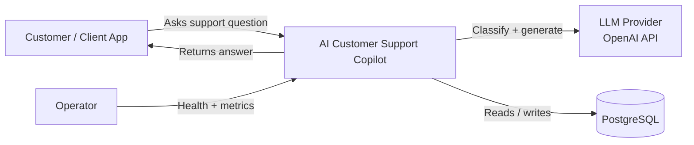
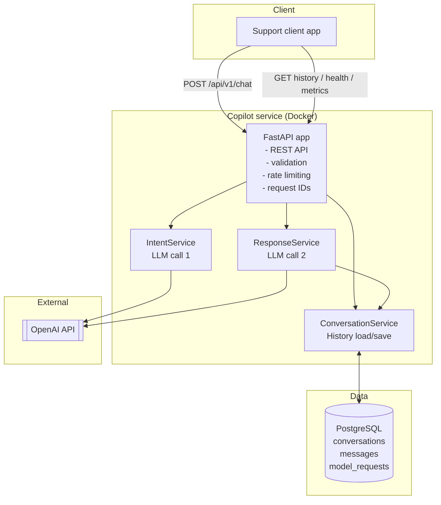
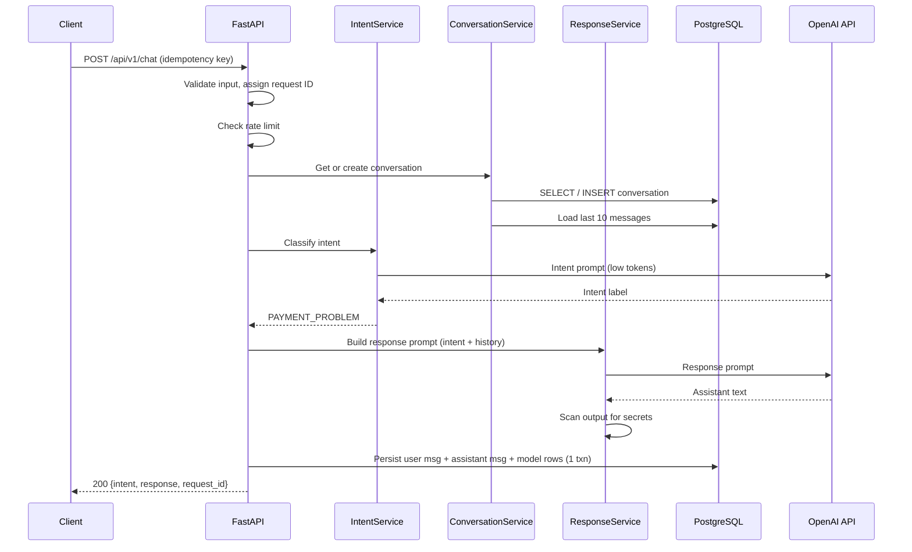
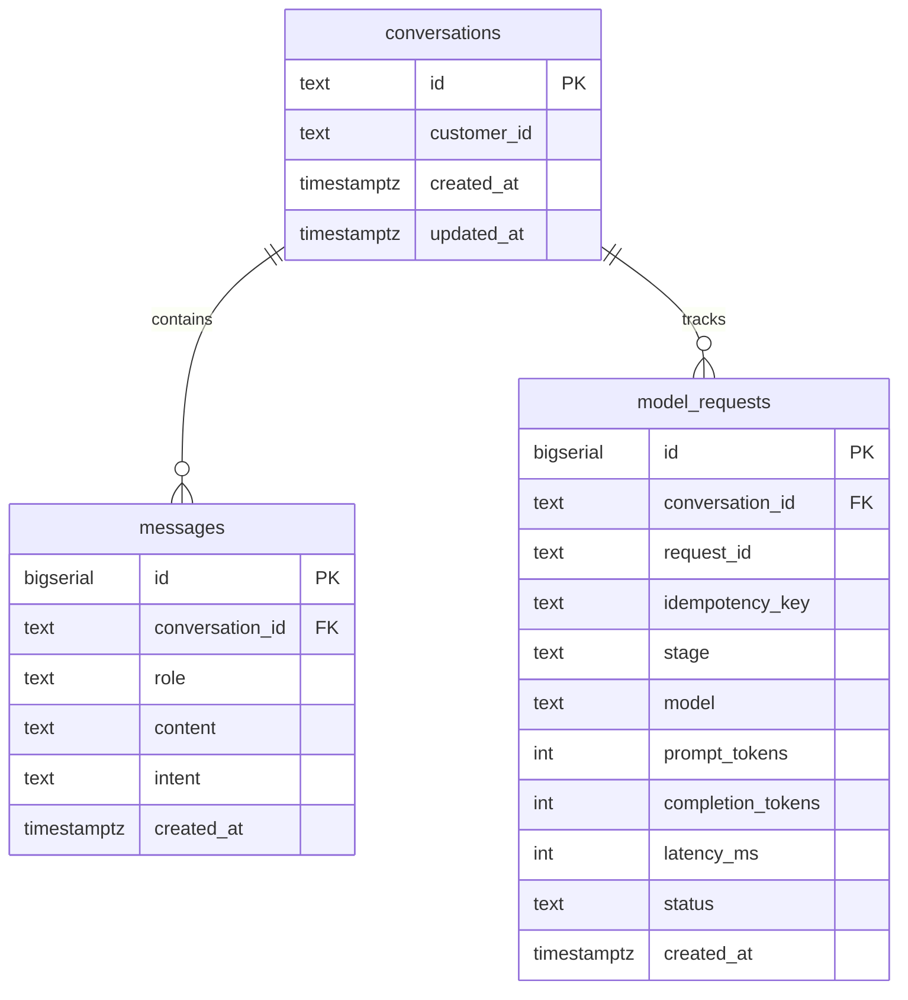
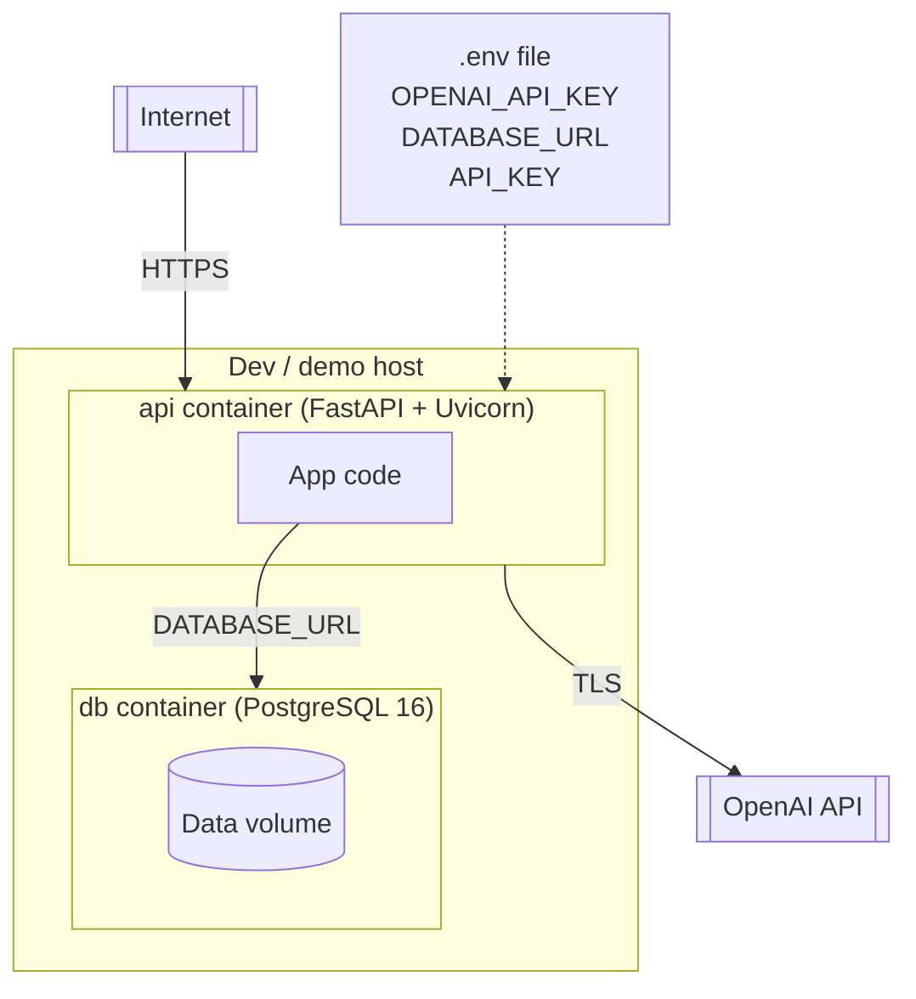

# Project 1 — AI Customer Support Copilot: Technical Design Document

## Document control

| Field | Value |
|---|---|
| Title | AI Customer Support Copilot — Architecture & Requirements |
| Author | Hemanth Janapala |
| Date | 2026-10-12 |
| Version | 0.3 |
| Timeline | Built May–June 2023 |
| Status | Draft — in design review |
| Reviewers | (self review; peer review before build Phase 1) |
| Stack | Python, FastAPI, Pydantic, OpenAI API, PostgreSQL, SQLAlchemy, Docker, pytest |

## Design review agenda (45 min)

| Time | Topic | Owner |
|---|---|---|
| 0–5 | Problem statement and goals | Author |
| 5–15 | Requirements walkthrough (functional + non-functional) | Author |
| 15–30 | Proposed architecture, diagrams, and key flows | Author |
| 30–38 | Data model and API contracts | Author |
| 38–43 | Risks, alternatives considered, open questions | All |
| 43–45 | Decision: approve, approve with comments, or revise | Reviewers |

Pre-read: sections 1–6 below. Come prepared with questions on sections 18–19.

## 1. Problem statement

Customer service teams get repetitive questions about orders, delivery, refunds, and payments. This project is a backend service that takes a natural-language support question, classifies intent, builds a structured prompt, calls an LLM, and returns a concise customer-friendly response with conversation history.

This is a fundamentals project. No RAG, no vector DB, no agents. The goal is to show clean LLM API usage, prompt design, REST API design, persistence, and production basics.

## 2. Goals and non-goals

Goals:
- Accept customer questions over REST and return helpful responses
- Classify intent into a fixed taxonomy before generating a response
- Keep multi-turn conversation history in PostgreSQL
- Handle LLM failures gracefully with retries and fallbacks
- Log requests, latency, and token usage for cost and quality analysis
- Ship with a small eval set that measures intent accuracy and reliability

Non-goals:
- No retrieval over documents (that is Project 2)
- No autonomous tool calling or planning (that is Project 3)
- No real customer data, no production PII
- No admin UI in v1 (API only, curl or simple client is enough)

## 3. Users and use cases

Primary user: a client app acting on behalf of a customer service workflow.

Use cases:
1. Customer asks a question, optionally in an existing conversation
2. Client fetches conversation history for display or audit
3. Operator checks service health and basic metrics
4. Developer runs the eval set to check intent accuracy and latency before merging

## 4. Functional requirements

FR-1: POST /api/v1/chat accepts customer_id, message, and optional conversation_id. Returns conversation_id, detected intent, and response text.
FR-2: Intent classification maps each message to exactly one of: ORDER_STATUS, DELIVERY_DELAY, REFUND, PAYMENT_PROBLEM, CANCEL_ORDER, PRODUCT_INFORMATION, GENERAL_SUPPORT.
FR-3: Response generation uses a separate prompt from intent classification, with recent conversation history included.
FR-4: If no conversation_id is supplied, the service creates a new conversation.
FR-5: GET /api/v1/conversations/{id} returns messages in chronological order.
FR-6: GET /api/v1/health returns service and dependency status.
FR-7: GET /api/v1/metrics returns aggregate stats: request count, error rate, p50/p95 latency, token totals.
FR-8: All LLM calls are logged with model name, prompt tokens, completion tokens, latency, and status.

## 5. Non-functional requirements (targets, not claims)

- Latency: p95 end-to-end under 3 seconds for chat, excluding client network. LLM timeout set to 10 seconds with one retry.
- Availability: single-instance target 99.5% in dev; design so a second API replica can be added without code changes (stateless API, shared DB).
- Throughput: handle 20 requests per second on a small container with connection pooling. This is a design target for load testing, not a claim.
- Data retention: conversation history kept indefinitely in v1, with a documented delete path per conversation.
- Cost: per-request token usage logged; monthly cost estimable from logs. No hard cap in v1, but metrics must expose it.
- Security: no secrets in code or images; all config from environment; input validation on every endpoint.
- Maintainability: typed code (Pydantic), layered structure (api, service, repository), unit test coverage on prompt and validation logic.

## 6. System architecture

### 6.1 System context diagram (C4 Level 1)



### 6.2 Container diagram (C4 Level 2)



### 6.3 Chat request sequence diagram



### 6.4 Component view

```
Client
  |
  v
FastAPI (REST API, validation, auth placeholder, rate limiting, request ID)
  |
  +-- IntentService (LLM call 1: classify intent, strict output parsing)
  |
  +-- ConversationService (load/save history from PostgreSQL)
  |
  +-- ResponseService (build prompt with history + intent, LLM call 2)
  |
  +-- Persistence (PostgreSQL via SQLAlchemy: conversations, messages, model_requests)
  |
  v
OpenAI API
```

Request flow:
1. Client POSTs to /api/v1/chat with idempotency key header.
2. API validates input, assigns request ID, checks rate limit per customer_id.
3. If conversation_id is new or missing, create conversation row.
4. Load last N messages (N=10) for context.
5. Call LLM for intent (short prompt, low max tokens, strict parsing, fallback to GENERAL_SUPPORT on parse failure).
6. Build response prompt: system instructions plus intent plus history plus current message.
7. Call LLM for response with timeout and one retry on transient errors.
8. Persist user message, assistant message, and model request row in one transaction.
9. Return response with request ID header.

Why two LLM calls: it separates concerns and makes each prompt testable. The tradeoff is double latency and cost, which is acceptable for a fundamentals project and worth calling out in interviews.

## 7. API design

### POST /api/v1/chat

Headers:
- `X-Request-Id` (optional, server generates if missing)
- `X-Idempotency-Key` (optional but recommended; same key returns the stored response without re-calling the LLM)

Request:
```json
{
  "customer_id": "C10291",
  "message": "I was charged twice for my order.",
  "conversation_id": "conv-1001"
}
```

Validation:
- customer_id: 1-64 chars, alphanumeric plus dash and underscore
- message: 1-2000 chars, stripped; reject empty or oversized with 422
- conversation_id: optional, 1-64 chars

Response 200:
```json
{
  "conversation_id": "conv-1001",
  "intent": "PAYMENT_PROBLEM",
  "response": "I'm sorry about the duplicate charge...",
  "request_id": "req-abc123"
}
```

Errors:
- 422 validation error with field-level details
- 429 rate limited with retry-after hint
- 502 LLM upstream failure after retries, with a safe fallback message and error logged
- 500 unexpected, with request ID for correlation

### GET /api/v1/conversations/{id}

Response 200:
```json
{
  "conversation_id": "conv-1001",
  "customer_id": "C10291",
  "messages": [
    {"role": "user", "content": "...", "intent": "PAYMENT_PROBLEM", "created_at": "..."},
    {"role": "assistant", "content": "...", "intent": "PAYMENT_PROBLEM", "created_at": "..."}
  ]
}
```

### GET /api/v1/health

```json
{"status": "ok", "database": "ok", "llm": "reachable", "version": "0.1.0"}
```

### GET /api/v1/metrics

```json
{
  "total_requests": 1234,
  "error_rate": 0.012,
  "latency_p50_ms": 1400,
  "latency_p95_ms": 2600,
  "total_prompt_tokens": 890000,
  "total_completion_tokens": 410000
}
```

## 8. Data design (PostgreSQL)

```sql
CREATE TABLE conversations (
  id TEXT PRIMARY KEY,
  customer_id TEXT NOT NULL,
  created_at TIMESTAMPTZ NOT NULL DEFAULT now(),
  updated_at TIMESTAMPTZ NOT NULL DEFAULT now()
);
CREATE INDEX ON conversations (customer_id);

CREATE TABLE messages (
  id BIGSERIAL PRIMARY KEY,
  conversation_id TEXT NOT NULL REFERENCES conversations(id) ON DELETE CASCADE,
  role TEXT NOT NULL CHECK (role IN ('user','assistant')),
  content TEXT NOT NULL,
  intent TEXT,
  created_at TIMESTAMPTZ NOT NULL DEFAULT now()
);
CREATE INDEX ON messages (conversation_id, created_at);

CREATE TABLE model_requests (
  id BIGSERIAL PRIMARY KEY,
  conversation_id TEXT REFERENCES conversations(id) ON DELETE SET NULL,
  request_id TEXT NOT NULL,
  idempotency_key TEXT,
  stage TEXT NOT NULL CHECK (stage IN ('intent','response')),
  model TEXT NOT NULL,
  prompt_tokens INT,
  completion_tokens INT,
  latency_ms INT NOT NULL,
  status TEXT NOT NULL CHECK (status IN ('ok','timeout','error','fallback')),
  created_at TIMESTAMPTZ NOT NULL DEFAULT now()
);
CREATE INDEX ON model_requests (created_at);
CREATE UNIQUE INDEX ON model_requests (idempotency_key) WHERE idempotency_key IS NOT NULL;
```

Notes:
- Store raw message text as sent by the client. Do not store API keys or secrets.
- PII policy for this portfolio project: use only synthetic customer IDs and messages. Document this in the README.

### Entity relationship diagram



### Deployment diagram (Docker Compose, v1)



## 9. LLM design

### Intent classification prompt

System:
```
Classify the customer request into exactly one of:
ORDER_STATUS, DELIVERY_DELAY, REFUND, PAYMENT_PROBLEM,
CANCEL_ORDER, PRODUCT_INFORMATION, GENERAL_SUPPORT.
Return only the label, nothing else.
```

Use low temperature (0.0) and small max tokens. Parse strictly; on any parse failure, log and fall back to GENERAL_SUPPORT rather than failing the request.

### Response generation prompt

System:
```
You are a helpful customer support assistant.
Be concise, professional, and empathetic.
Do not invent company policies, order numbers, or refund amounts.
If the available information is insufficient, say so and suggest a next step.
```

User content assembled by the service:
```
Customer intent: PAYMENT_PROBLEM

Conversation history (most recent last):
User: ...
Assistant: ...

Current customer message:
...

Generate a helpful response.
```

History window: last 10 messages, truncated to fit a configured max prompt size. Deliberately simple; no summarization in v1.

### Guardrails (v1, lightweight)

- Blocklist: refuse to output anything resembling a password, API key, or credit card number; the service scans the LLM output with a simple pattern check before returning.
- Length cap: truncate assistant responses at a sane limit and note truncation in logs.
- No policy invention: the system prompt explicitly forbids inventing policies; eval checks for this.

## 10. Reliability

- Timeouts: 10s per LLM call, 5s for DB.
- Retries: one retry on timeout or 5xx from the LLM provider, with jittered backoff. No retry on 4xx or validation errors.
- Fallback: if both attempts fail, return a safe message ("I'm having trouble right now, please try again in a moment.") and log status=fallback. Never return a stack trace.
- Idempotency: X-Idempotency-Key stored in model_requests; repeat requests with the same key return the original response without new LLM calls.
- Rate limiting: 30 requests per minute per customer_id (in-memory token bucket in v1, documented as not shared across replicas).
- DB transactions: user message, assistant message, and model request rows written atomically.
- Graceful shutdown: FastAPI lifespan handler drains in-flight requests.

## 11. Observability

- Structured JSON logs with request_id, customer_id (hashed in logs if you want to be strict), stage, latency_ms, model, token counts, status.
- Metrics endpoint plus Prometheus-style counters if you add prometheus_client later (optional in v1).
- Trace per chat request: validation -> intent call -> history load -> response call -> persist, each with latency.
- Alerting (documented, not wired in v1): p95 latency above target, error rate above 2%, LLM timeout rate spike.

## 12. Security

- Auth: v1 uses an API key header placeholder (X-API-Key) with a documented TODO for real auth. Do not ship without at least this.
- Secrets: OPENAI_API_KEY and DATABASE_URL from environment only. Never log them.
- Input validation: Pydantic on all inputs, max lengths enforced, content stripped.
- Output scanning: pattern check for secrets before returning LLM text.
- Dependencies: pinned requirements.txt, Docker base image pinned by digest in v1.
- Data: synthetic data only in repo, tests, and README examples.

## 13. Testing strategy

- Unit: prompt builders, intent parser, validators, idempotency logic.
- Integration: FastAPI test client with mocked LLM and real PostgreSQL (testcontainers or a local test DB).
- Contract: OpenAPI schema snapshot test so accidental breaking changes are caught.
- Eval: `evaluation/` folder with 50-100 synthetic support questions, each with expected intent and a prohibited-hallucination note. Script reports intent accuracy, success rate, p50/p95 latency, fallback rate. Targets: intent accuracy above 90%, success above 98%, p95 under 3s. These are targets until measured.
- Load: simple k6 or locust script for 20 rps smoke test (optional in v1, documented).

## 14. Repository structure

```
ai-customer-support-copilot/
  app/
    api/routes.py
    services/llm_service.py
    services/intent_service.py
    services/conversation_service.py
    prompts/intent.txt
    prompts/response.txt
    models/
    repositories/
    config.py
    main.py
  evaluation/questions.json
  evaluation/evaluate.py
  tests/
  scripts/
  Dockerfile
  docker-compose.yml
  requirements.txt
  README.md
  ARCHITECTURE.md (this file)
```

## 15. Configuration

Environment variables:
- OPENAI_API_KEY (secret)
- OPENAI_MODEL (default from provider docs at build time)
- DATABASE_URL
- API_KEY (for X-API-Key auth)
- INTENT_MAX_TOKENS, RESPONSE_MAX_TOKENS
- HISTORY_WINDOW (default 10)
- LLM_TIMEOUT_S (default 10)
- RATE_LIMIT_PER_MINUTE (default 30)

## 16. Build phases (solo-friendly, corporate order)

Phase 0: scaffold repo, Docker compose with Postgres, health endpoint, config from env. Done, 7 tests passing.
Phase 1: POST /chat with mocked LLM, validation, request IDs, conversation creation. Done, in-memory store. Eval harness runs: 10/12 intent accuracy on the keyword mock, 0 failures.
Phase 2: real intent call plus response call, history window, persistence, idempotency. Done: OpenAI client with timeout + one retry, strict intent parsing with GENERAL_SUPPORT fallback, secret-output scanning, PostgreSQL persistence for conversations/messages/model_requests with per-call token logging. Degraded mode (no API key or DB) keeps Phase 1 behavior. 12 tests passing.
Phase 3: retries, fallback, rate limiting, metrics endpoint, structured logging. Done: JSON structured logging with request_id correlation across access and chat logs, SHA-256 hashed customer IDs in logs, per-stage LLM log lines with tokens and latency, extended /metrics (LLM call/error counts, token totals). Retries, fallback handling, and rate limiting were already implemented in Phases 1-2. 15 tests passing.
Phase 4: eval set plus evaluate.py, measure and record actual numbers, README with honest results.
Phase 5: hardening pass: output scanning, API key auth, load smoke test, pinned images.

## 17. README contract (what "done" looks like)

- What it does and the request flow diagram
- How to run with Docker compose
- API examples with curl
- Configuration table
- Eval: how to run, what was measured, actual numbers (or "not yet measured")
- Known limitations and what v2 would add
- No real data, no secrets, no invented metrics

## 18. Alternatives considered

| Option | Verdict | Reason |
|---|---|---|
| Single LLM call (classify + respond in one prompt) | Rejected for v1 | Cheaper and faster, but prompts become untestable blobs and intent accuracy cannot be measured independently |
| ML classifier (e.g., fine-tuned model) for intent | Rejected for v1 | More accurate at scale, but overkill for 7 intents and adds training pipeline complexity; revisit if eval shows intent accuracy below target |
| Redis for conversation history | Rejected for v1 | Faster reads, but PostgreSQL is sufficient at this scale and keeps the stack to one datastore |
| Streaming responses (SSE) | Deferred to v2 | Better UX for long answers, but adds client complexity; v1 responses are short enough for request/response |

## 19. Risks and open questions

- Two LLM calls double cost and latency. Acceptable for v1; document the tradeoff.
- Intent taxonomy is fixed. New intents require prompt plus eval updates.
- In-memory rate limiting does not share state across replicas. Fine for v1, noted for v2 (Redis).
- Model behavior changes over time. Pin the model name in config and re-run evals when it changes.
